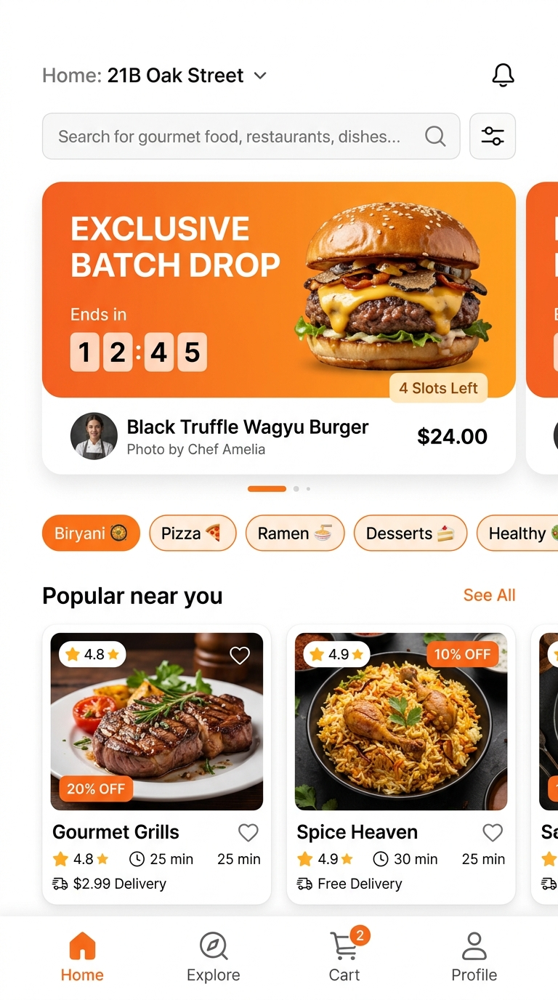
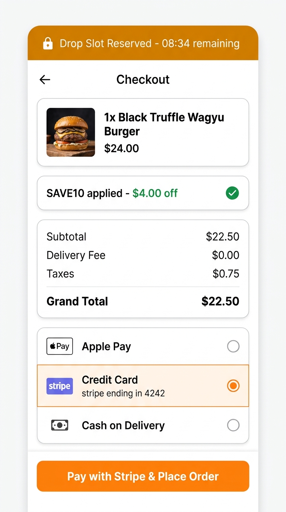
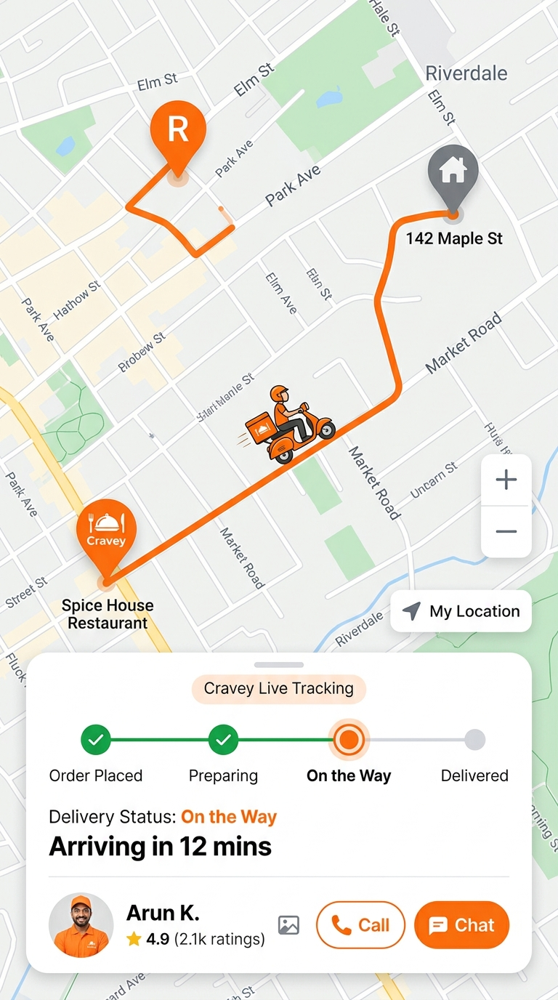
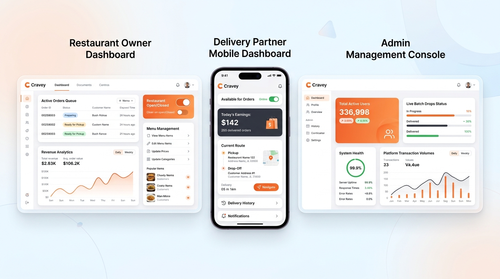
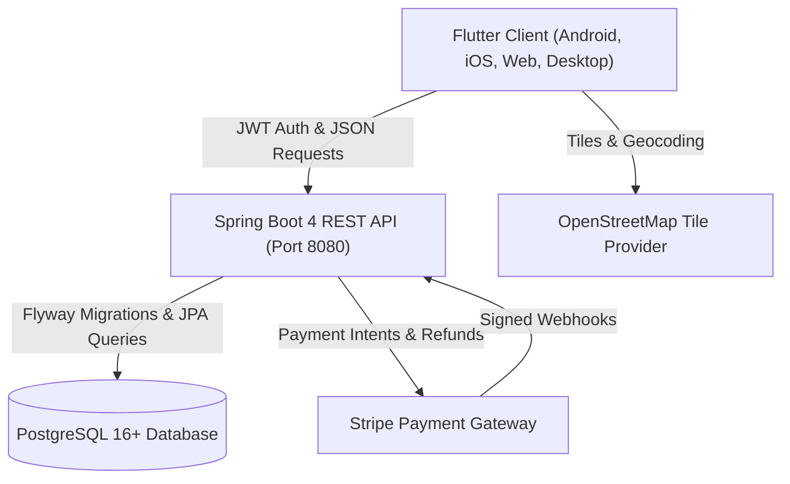

# Cravey 🍊

[](.github/workflows/ci.yml)
[](https://flutter.dev)
[](https://dart.dev)
[](https://spring.io/projects/spring-boot)
[](https://openjdk.org)
[](https://www.postgresql.org)
[](LICENSE)

> **Cravey** is an end-to-end, full-stack food delivery and curated dish discovery platform designed for high-concurrency **limited-quantity batch drops**. Built with a high-performance **Flutter** frontend across mobile, web, and desktop, coupled with an enterprise-grade **Spring Boot** backend featuring strict inventory invariants, idempotent Stripe payments, and multi-role operations.

---

## Table of Contents

- [What Cravey Does](#what-cravey-does)
- [Why Cravey Is Useful](#why-cravey-is-useful)
- [Feature Walkthrough & Screenshots](#feature-walkthrough--screenshots)
- [Architecture & Tech Stack](#architecture--tech-stack)
- [Project Structure](#project-structure)
- [Getting Started](#getting-started)
  - [Prerequisites](#prerequisites)
  - [1. Clone Repository](#1-clone-repository)
  - [2. Backend Setup & Run](#2-backend-setup--run)
  - [3. Frontend Setup & Run](#3-frontend-setup--run)
  - [Demo Accounts & Role Access](#demo-accounts--role-access)
- [Testing & Quality Assurance](#testing--quality-assurance)
- [API Specification](#api-specification)
- [Where to Get Help](#where-to-get-help)
- [Maintainers & Contributing](#maintainers--contributing)
- [License](#license)

---

## What Cravey Does

Cravey bridges the gap between conventional on-demand delivery and viral, limited-edition culinary events. While traditional delivery platforms struggle with flash-sale inventory overbooking and race conditions, Cravey introduces:

1. **Curated Batch Drops**: Timed culinary flash events with guaranteed slot holds for buyers.
2. **Zero-Oversell Slot Invariant**: Mathematically verified slot accounting ensuring inventory is never oversold under massive concurrency.
3. **Four-Role Unified Platform**: Specialized interfaces and workflows for **Customers**, **Restaurant Owners**, **Delivery Partners**, and **Platform Admins**.
4. **Live Turn-by-Turn Tracking**: Real-time OpenStreetMap route rendering without proprietary map vendor lock-in.
5. **Decoupled Deterministic Cart**: Offline-first, pure business logic decoupled from network synchronization for zero-latency client math.

---

## Why Cravey Is Useful

- **Guaranteed Inventory Integrity**: Solves the classic flash-sale race condition with a strictly enforced database invariant:
  $$\text{Drop.reservedSlots} = \text{count}(\text{HELD}) + \text{count}(\text{CONFIRMED})$$
  Drop reservations atomically hold slots with an automated TTL release scheduler, anti-hoarding limits, and atomic rollback upon payment failure or drop cancellation.
- **Resilient Financial Transactions**: Integrates Stripe PaymentSheet with atomic webhook idempotency (`ProcessedWebhookEventRepository`), preventing duplicate charges from network retries and automatically refunding customers if a drop slot is reclaimed.
- **Multi-Role Coordination**:
  - **Customer**: Browse batch drops, explore menus, apply promo coupons, pay via Stripe, and monitor live deliveries.
  - **Restaurant Owner**: Live kitchen order queue, stock/menu updates, and store open/closed toggles.
  - **Delivery Partner**: Order acceptance, GPS delivery routing, status transitions, and earnings ledger.
  - **Admin**: Platform health, user privilege management, restaurant verification, and transaction analytics.
- **Enterprise Testing Rigor**: Over **117 backend tests** (including 50-user concurrent reserve race conditions verified against real PostgreSQL instances via Testcontainers) and **48 Flutter tests** spanning characterization, state, and widget testing.

---

## Feature Walkthrough & Screenshots

### 1. Curated Batch Drops & Home Screen
Discover limited-run culinary creations from top-tier kitchens with live countdown timers and real-time remaining slot counters.

<p align="center">
  
</p>

*Key Highlights*:
- Live countdown banner displaying active drop time remaining and reserved slot counts.
- Dynamic cuisine filters (Biryani, Wood-Fired Pizza, Ramen, Gourmet Grills, Desserts).
- Instant search bar with debounced querying and pagination.
- Email verification awareness banner with one-tap resend capability.

---

### 2. Drop Slot Hold & One-Click Checkout
When a user begins checkout for an exclusive drop, their slot is held with an active countdown banner, preventing other users from sniping the item while they complete payment.

<p align="center">
  
</p>

*Key Highlights*:
- Amber top banner indicating guaranteed slot reservation and hold countdown.
- Live coupon engine validating discounts (e.g., `SAVE10`, `WELCOME50`).
- Transparent cost breakdown (Subtotal, Delivery Fee, Taxes, Platform Fees).
- Integrated Stripe PaymentSheet (Credit/Debit Card, Apple Pay, Cash on Delivery).

---

### 3. Live Interactive Order Tracking
Track your food in real-time from the restaurant's kitchen to your doorstep with interactive map integration powered by OpenStreetMap.

<p align="center">
  
</p>

*Key Highlights*:
- Embedded OpenStreetMap canvas with custom polyline route rendering.
- Animated courier marker reflecting real-time movement along the delivery path.
- 4-step progressive timeline (`Order Placed` $\to$ `Preparing` $\to$ `On the Way` $\to$ `Delivered`).
- Driver quick-dial and in-app chat actions.

---

### 4. Multi-Role Partner & Admin Consoles
Dedicated control centers tailored for restaurant managers, delivery couriers, and platform administrators.

<p align="center">
  
</p>

*Key Highlights*:
- **Restaurant Console**: Incoming order pipeline, preparation status toggling, and menu availability controls.
- **Delivery App**: Online/offline status toggle, active order dispatching, and daily earnings summary.
- **Admin Management**: Global order volume charts, system health monitoring, and user role management.

---

## Architecture & Tech Stack



### Technology Matrix

| Layer | Technologies | Description |
| :--- | :--- | :--- |
| **Mobile & Web UI** | Flutter 3.44.x, Dart 3.12.x | Cross-platform client for Android, iOS, Web, macOS, Windows |
| **State Management** | `provider` (`SessionProvider`, `CartState`) | Decoupled reactive state with `ChangeNotifier` pattern |
| **Client Networking** | `dio`, `AuthInterceptor` | Single-flight queued token refresh on 401 Unauthorized |
| **Client Storage** | `flutter_secure_storage`, `shared_preferences` | Encrypted JWT token storage and user preferences |
| **Mapping** | `flutter_map`, `latlong2` | Lightweight OpenStreetMap raster rendering with polyline routing |
| **Backend Runtime** | Spring Boot 4.0.5, Java 26 / OpenJDK 17+ | High-throughput reactive REST API backend |
| **Database & ORM** | PostgreSQL 16+, Spring Data JPA, Hibernate | Relational persistence with partial unique indexes |
| **DB Migrations** | Flyway (`flyway-core`, `flyway-database-postgresql`) | Versioned schema migrations (`V1`, `V2`) |
| **Payments** | Stripe Java SDK, `flutter_stripe` | Secure PaymentSheet and idempotent webhook processing |
| **Integration Testing**| Testcontainers PostgreSQL | Real database integration and 50-user concurrency verification |

---

## Project Structure

```text
cravey/
├── .github/
│   └── workflows/
│       └── ci.yml               # Unified CI pipeline (Flutter + Spring Boot Testcontainers)
├── backend/                     # Spring Boot 4 Application
│   ├── src/
│   │   ├── main/
│   │   │   ├── java/com/example/zomato/
│   │   │   │   ├── config/      # Security, CORS & DataInitializer
│   │   │   │   ├── controller/  # REST controllers (Drop, Order, Payment, Auth)
│   │   │   │   ├── drops/       # Drop & DropReservation domain services
│   │   │   │   ├── gateway/     # StripeGateway abstraction
│   │   │   │   ├── models/      # JPA entities (User, Order, Drop, Reservation)
│   │   │   │   ├── repository/  # Spring Data repositories with pessimistic/atomic locks
│   │   │   │   └── services/    # Business services (Order, Payment, Auth, Cart)
│   │   │   └── resources/
│   │   │       ├── db/migration/# Flyway SQL migrations (V1, V2)
│   │   │       └── application.yml
│   │   └── test/                # 117 unit, integration & Testcontainers concurrency tests
│   ├── pom.xml                  # Maven build configuration
│   └── mvnw                     # Maven Wrapper
├── docs/
│   └── screenshots/             # High-resolution feature screenshots
├── lib/                         # Flutter Cross-Platform Client
│   ├── controllers/             # UI workflow controllers (CheckoutController)
│   ├── models/                  # Domain entities, OpenAPI DTOs & PureCart
│   ├── repositories/            # Repository interfaces & live API implementations
│   ├── screens/                 # Mobile & web views (Home, Cart, Checkout, Dashboards)
│   ├── services/                # Network services (ApiClient, AuthService, PaymentService)
│   ├── theme/                   # Citrus palette, typography & widget styles
│   ├── widgets/                 # Reusable components (Header, FoodCard, Map, Sheets)
│   └── main.dart                # Application entrypoint & Provider tree
├── test/                        # Flutter test suite (48 unit, widget & characterization tests)
├── openapi.yaml                 # OpenAPI 3.0 REST contract specification
├── pubspec.yaml                 # Flutter package dependencies
├── CONTRIBUTING.md              # Contribution guide
└── LICENSE                      # MIT License
```

---

## Getting Started

### Prerequisites

Ensure you have the following installed on your development workstation:
- **Flutter SDK**: `^3.44.0` ([Installation Guide](https://docs.flutter.dev/get-started/install))
- **Java Development Kit**: JDK 17+ or JDK 21+ ([Adoptium Temurin](https://adoptium.net/))
- **Docker**: Required for backend integration tests via Testcontainers
- **PostgreSQL** *(Optional for local manual dev; H2 in-memory is enabled by default for rapid dev)*

---

### 1. Clone Repository

```bash
git clone https://github.com/NitikasriJeyanAchary0109/cravey.git
cd cravey
```

---

### 2. Backend Setup & Run

The backend includes a pre-configured Maven wrapper.

1. Navigate to the `backend/` directory:
   ```bash
   cd backend
   ```
2. Build and run the service:
   ```bash
   ./mvnw spring-boot:run
   ```
3. The server starts on **`http://localhost:8080`**.
   - Default dev profile automatically seeds initial menu items, restaurants, and demo users.
   - Swagger / OpenAPI definitions are accessible directly in [openapi.yaml](openapi.yaml).

---

### 3. Frontend Setup & Run

1. From the project root, install Flutter dependencies:
   ```bash
   flutter pub get
   ```
2. Verify Flutter development environment:
   ```bash
   flutter doctor
   ```
3. Launch on your target platform:

#### Running on Web (Google Chrome)
```bash
flutter run -d chrome --web-port=8080
```

#### Running on Android Emulator / Physical Device
```bash
flutter run -d android
```

#### Running on iOS Simulator (macOS only)
```bash
flutter run -d ios
```

#### Custom Backend URL Configuration
You can pass custom backend hosts and Stripe keys using `--dart-define`:
```bash
flutter run -d chrome \
  --dart-define=API_BASE_URL=http://localhost:8080 \
  --dart-define=STRIPE_PUBLISHABLE_KEY=pk_test_your_key_here
```

| Compile-Time Parameter | Default Fallback | Purpose |
| :--- | :--- | :--- |
| `API_BASE_URL` | `http://localhost:8080` (Web/iOS)<br>`http://10.0.2.2:8080` (Android) | Host URL for backend API |
| `STRIPE_PUBLISHABLE_KEY` | `pk_test_placeholder` | Stripe publishable key for client payments |

---

### Demo Accounts & Role Access

Cravey includes pre-seeded demo accounts for instant testing of all platform workflows:

| Role | Demo Email | Password | Access Capabilities |
| :--- | :--- | :--- | :--- |
| **Customer** | `customer@cravey.com` | `Password123!` | Browse, reserve batch drops, cart, checkout, live tracking |
| **Restaurant Owner** | `owner@cravey.com` | `Password123!` | Live order queue, prep timer, menu management |
| **Delivery Partner** | `driver@cravey.com` | `Password123!` | Accept orders, turn-by-turn routing, earnings history |
| **Administrator** | `admin@cravey.com` | `Password123!` | System metrics, user privileges, restaurant verification |

> **Tip**: You can also use the in-app **Demo Login** buttons on the Login Screen or the **Role Switcher** in the drawer to instantly test different views without logging out.

---

## Testing & Quality Assurance

Cravey enforces rigorous automated testing across both client and server layers.

### Run Frontend Tests
```bash
# Analyze code for warnings and lints
dart analyze

# Run all 48 Flutter unit, widget, and characterization tests
flutter test
```

### Run Backend Tests
```bash
cd backend

# Run fast unit and integration tests (117 tests)
./mvnw clean test

# Run full suite including PostgreSQL Testcontainers concurrency tests
./mvnw clean verify -Ppostgres
```

### CI/CD Workflow
All pull requests and commits to `main` are continuously validated via [`.github/workflows/ci.yml`](.github/workflows/ci.yml) which executes:
1. Flutter code analysis (`dart analyze`)
2. Flutter unit & widget tests (`flutter test`)
3. Spring Boot test suite with Dockerized PostgreSQL Testcontainers

---

## API Specification

The REST API contract is fully documented using **OpenAPI 3.0**. View the complete schema in [openapi.yaml](openapi.yaml).

Primary API endpoints include:
- `POST /api/auth/**`: Registration, login, JWT refresh tokens, and email verification.
- `GET/POST /api/drops/**`: Batch drop discovery, real-time slot reservation, and release.
- `GET/POST /api/cart/**`: Remote cart synchronization and validation.
- `POST /api/orders/**`: Order creation, reservation binding, and order lifecycle status.
- `POST /payment/**`: Stripe PaymentIntent creation, payment verification, and webhooks.
- `GET /api/restaurants/**`: Restaurant directory, cuisine categorization, and menus.

---

## Where to Get Help

- **Documentation**: Browse [openapi.yaml](openapi.yaml) for REST contract specifications and endpoint models.
- **Issue Tracker**: If you identify a bug or would like to request an enhancement, please submit an issue on the [GitHub Issues](https://github.com/NitikasriJeyanAchary0109/cravey/issues) page.
- **Discussions**: Start a conversation or ask architectural questions in the repository's discussions section.

---

## Maintainers & Contributing

Maintained with ❤️ by [Nitikasri Achary](https://github.com/NitikasriJeyanAchary0109) and open source contributors.

Contributions are enthusiastically welcomed! Please review our [Contributing Guide](CONTRIBUTING.md) for details on branching strategy, code style, and submitting pull requests.

---

## License

This project is licensed under the **MIT License** — see the [LICENSE](LICENSE) file for details.
