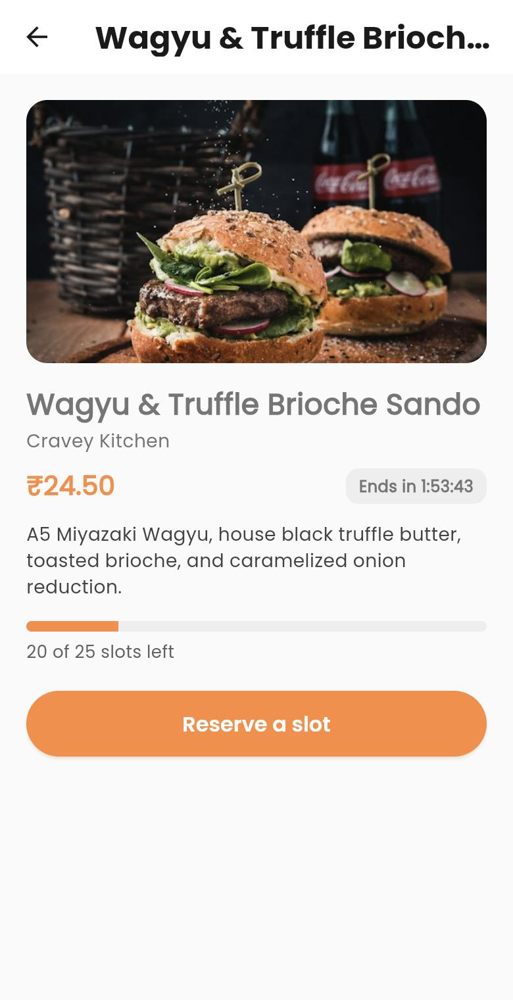
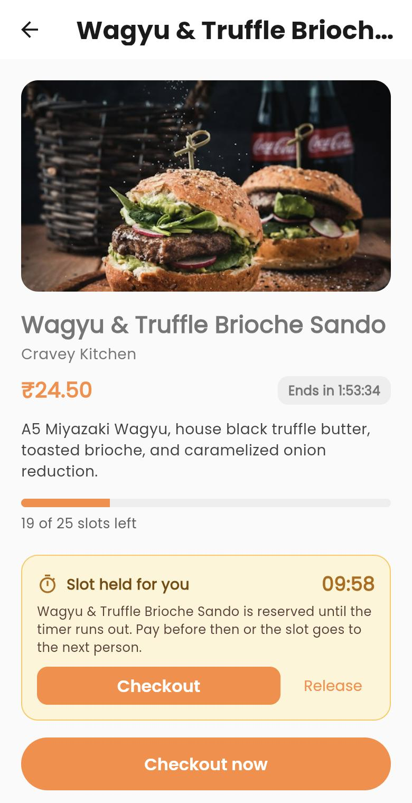
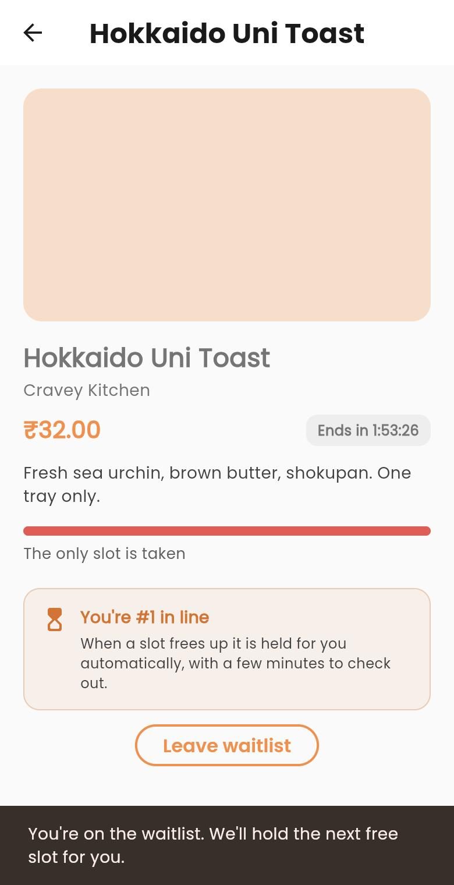
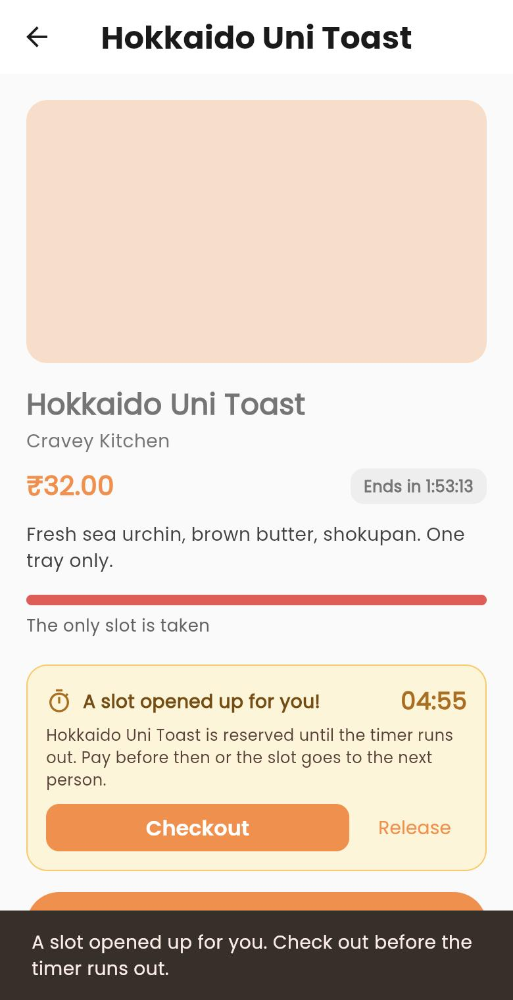
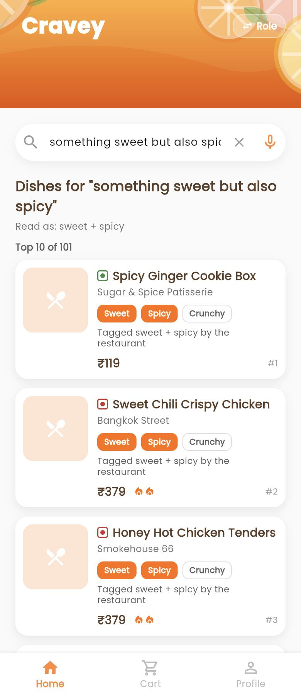
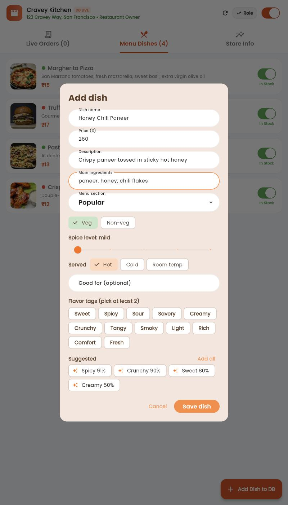

# Cravey 🍊

[](.github/workflows/ci.yml)
[](https://flutter.dev)
[](https://dart.dev)
[](https://spring.io/projects/spring-boot)
[](https://openjdk.org)
[](https://www.postgresql.org)
[](LICENSE)

> **Cravey** is an end-to-end, full-stack food delivery and curated dish discovery platform designed for high-concurrency **limited-quantity batch drops**. Built with a high-performance **Flutter** frontend across mobile, web, and desktop, coupled with an enterprise-grade **Spring Boot** backend featuring strict inventory invariants, idempotent Stripe payments, and multi-role operations.

---

## Table of Contents

- [What Cravey Does](#what-cravey-does)
- [Why Cravey Is Useful](#why-cravey-is-useful)
- [Feature Walkthrough & Screenshots](#feature-walkthrough--screenshots)
- [How Drops Work](#how-drops-work)
- [Craving Search](#craving-search)
- [Architecture & Tech Stack](#architecture--tech-stack)
- [Project Structure](#project-structure)
- [Getting Started](#getting-started)
  - [Prerequisites](#prerequisites)
  - [1. Clone Repository](#1-clone-repository)
  - [2. Backend Setup & Run](#2-backend-setup--run)
  - [3. Frontend Setup & Run](#3-frontend-setup--run)
  - [Demo Accounts & Role Access](#demo-accounts--role-access)
- [Testing & Quality Assurance](#testing--quality-assurance)
- [API Specification](#api-specification)
- [Where to Get Help](#where-to-get-help)
- [Maintainers & Contributing](#maintainers--contributing)
- [License](#license)

---

## What Cravey Does

Cravey bridges the gap between conventional on-demand delivery and viral, limited-edition culinary events. While traditional delivery platforms struggle with flash-sale inventory overbooking and race conditions, Cravey introduces:

1. **Curated Batch Drops**: Timed culinary flash events where a customer reserves one of a limited number of slots and gets a live countdown while paying.
2. **Zero-Oversell Slot Invariant**: Slot accounting is enforced by single atomic SQL statements and a partial unique index, and is checked by concurrency tests against real PostgreSQL (500 customers racing for 20 slots, two app instances racing for one customer).
3. **Fair Waitlist**: When a hold lapses or is released, the slot is handed straight to the oldest person in line, never back to the open pool where a faster tap could steal it.
4. **Search by Craving**: type "something sweet but also spicy" and get the top dishes with the reason each matched, from a hybrid retrieval pipeline (embeddings + keywords + flavor tags) with no LLM. See [Craving Search](#craving-search).
5. **Four-Role Unified Platform**: Specialized interfaces and workflows for **Customers**, **Restaurant Owners**, **Delivery Partners**, and **Platform Admins**.
6. **Live Turn-by-Turn Tracking**: Real-time OpenStreetMap route rendering without proprietary map vendor lock-in.
7. **Decoupled Deterministic Cart**: Offline-first, pure business logic decoupled from network synchronization for zero-latency client math.

---

## Why Cravey Is Useful

- **Guaranteed Inventory Integrity**: The classic flash-sale race is closed by a database invariant:
  $$\text{Drop.reservedSlots} = \text{count}(\text{HELD}) + \text{count}(\text{CONFIRMED})$$
  A hold lasts 10 minutes, checkout guarantees at least 5 more, a payment that is genuinely in flight keeps the hold alive (hard cap 20 minutes), and a sweeper releases everything else. See [How Drops Work](#how-drops-work).
- **Resilient Financial Transactions**: Integrates Stripe PaymentSheet with atomic webhook idempotency (`ProcessedWebhookEventRepository`). If a customer pays after their hold lapsed and the slot is gone, the order is cancelled at once and the refund is retried with back-off until it succeeds.
- **Multi-Role Coordination**:
  - **Customer**: Browse batch drops, explore menus, apply promo coupons, pay via Stripe, and monitor live deliveries.
  - **Restaurant Owner**: Live kitchen order queue, stock/menu updates, and store open/closed toggles.
  - **Delivery Partner**: Order acceptance, GPS delivery routing, status transitions, and earnings ledger.
  - **Admin**: Platform health, user privilege management, restaurant verification, and transaction analytics.
- **Testing Rigor**: **182 backend tests** (including 500-customer and multi-instance races against real PostgreSQL via Testcontainers), **117 Flutter tests** (state, widgets, checkout flows, and contract tests parsing JSON captured from a live backend), and a [live smoke script](scripts/demo/e2e_drops_smoke.py). See the [concurrency report](docs/concurrency-report.md).

---

## Feature Walkthrough & Screenshots

### 1. Limited Drops on the Home Screen
Live drops, remaining slots and status chips come straight from `GET /drops` and refresh every few seconds.

<p align="center">
  
</p>

---

### 2. Reserve, Hold and Pay
Reserving takes one slot out of the pool for 10 minutes. The countdown follows the **server's** clock (every response carries `serverTime`), so a wrong phone clock can neither hide an expiry nor fake one.

<p align="center">
  
  
  
</p>

*Key Highlights*:
- The order is priced on the server from the drop, never from the client.
- Retrying a failed payment reuses the same order; a second order is never created for one hold.
- If the hold expires mid-checkout the app says so and offers the drop again.

---

### 3. Waitlist with Slot Hand-off
When a drop is sold out the customer joins a FIFO waitlist and sees their place. When any slot is released, cancelled or expires, it is handed to the oldest waiter as a held reservation with its own countdown, with no moment where it looks free.

<p align="center">
  
  
</p>

---

### 4. Live Interactive Order Tracking
Track your food in real-time from the restaurant's kitchen to your doorstep with interactive map integration powered by OpenStreetMap.

<p align="center">
  
</p>

*Key Highlights*:
- Embedded OpenStreetMap canvas with custom polyline route rendering.
- Animated courier marker reflecting real-time movement along the delivery path.
- 4-step progressive timeline (`Order Placed` $\to$ `Preparing` $\to$ `On the Way` $\to$ `Delivered`).
- Driver quick-dial and in-app chat actions.

---

### 5. Multi-Role Partner & Admin Consoles
Dedicated control centers tailored for restaurant managers, delivery couriers, and platform administrators.

<p align="center">
  
</p>

*Key Highlights*:
- **Restaurant Console**: Incoming order pipeline, preparation status toggling, and menu availability controls.
- **Delivery App**: Online/offline status toggle, active order dispatching, and daily earnings summary.
- **Admin Management**: Global order volume charts, system health monitoring, and user role management.

---

## How Drops Work

**One timer rule** (all values are properties under `drops.*`):

| Moment | What happens |
| :--- | :--- |
| Reserve | The slot is held for **10 min** (`hold-minutes`). |
| Checkout started | At least **5 more minutes** remain (`min-payment-minutes`); a longer hold is never shortened. |
| Payment in flight | Creating the PaymentIntent and Stripe's `processing` / `requires_action` webhooks extend the hold to now + **5 min** (`payment-grace-minutes`). |
| Hard cap | No extension ever passes `createdAt + 20 min` (`hard-cap-minutes`). |
| Hold lapses unpaid | The sweeper (every 15 s) expires it, cancels the unpaid order and its PaymentIntent, and frees the slot. It is the only thing that frees slots on a timer. |
| Waitlist offer | A handed-over slot is held for **5 min** (`offer-minutes`). |

**Slot hand-off.** Whenever a held or confirmed slot is released, cancelled, refunded or expires and somebody is waiting, `reservedSlots` is *not* decremented; the slot becomes a new HELD reservation for the oldest waiter in the same transaction. A scheduler pass offers free slots to waiters when capacity is raised, and expires waiters when a drop ends.

**Late payments.** If the hold lapsed and the slot is still free, the payment reclaims it and the order is revived. If the slot is gone (or the customer holds a newer reservation), the order is cancelled immediately so the kitchen never sees it, and the refund is retried with exponential back-off (`GET /payment/refunds/failed` lists what is still failing, admins only).

**Across app instances.** A per-user lock only reduces contention. The partial unique indexes decide: the losing transaction fails whole, including its slot increment, and then resolves to the winner's reservation.

---

## Craving Search

The search bar understands cravings: *"something sweet but also spicy"*, *"creamy and comforting"*, *"a drink to cool down"*,
*"spicy vegetarian under 300"*. The top matches appear under the bar with the flavors they carry and why they matched.

<p align="center">
  
  
</p>

**It is retrieval, not generation.** Four independent rankings are merged with Reciprocal Rank Fusion: embeddings
(BAAI/bge-small-en-v1.5 through ONNX Runtime, inside the backend), BM25 (words, plurals, typos), each part of the craving
scored on its own, and flavor tags. Dishes that cover every requested flavor get a lift. Without the model files the
search still works on keywords and tags and reports `mode: KEYWORD`.

**The data comes from the owners.** The add-dish form asks for flavor tags (at least two, from a fixed list of 12),
spice level, serving temperature, ingredients and mood, and suggests tags live as the owner types. A dish saved without
tags gets automatic suggestions (marked `AUTO`; owner-confirmed ones count more). Every save updates the search index
immediately.

```bash
scripts/search/download_model.sh            # one-time, 133 MB (MIT license); the backend finds it in backend/models
# load the demo catalog (8 restaurants, 126 dishes with tags), as an admin:
curl -X POST http://localhost:8080/admin/search/seed -H "Authorization: Bearer <admin token>"
curl "http://localhost:8080/search/dishes?q=something%20sweet%20but%20also%20spicy&k=10"
```

How well it works, what was tried and what did not help: [docs/search-quality-report.md](docs/search-quality-report.md).
Searches are logged anonymously (what was typed, whether the menus could answer it, which result was tapped) as the base for
trending-craving suggestions to restaurants (an Insights tab for owners, "Trending cravings" chips for customers): [docs/search-insights.md](docs/search-insights.md).
In short, on the demo catalog with automatically tagged dishes the first result is relevant far more often than with
keywords alone (MRR 0.90 vs 0.82), and good owner tags matter most (recall 0.73 to 0.89). The catalog and queries are
synthetic, so read it as proof the pipeline works, not as a benchmark.

---

## Architecture & Tech Stack


### Technology Matrix

| Layer | Technologies | Description |
| :--- | :--- | :--- |
| **Mobile & Web UI** | Flutter 3.44.x, Dart 3.12.x | Cross-platform client for Android, iOS, Web, macOS, Windows |
| **State Management** | `provider` (`SessionProvider`, `CartState`) | Decoupled reactive state with `ChangeNotifier` pattern |
| **Client Networking** | `dio`, `AuthInterceptor` | Single-flight queued token refresh on 401 Unauthorized |
| **Client Storage** | `flutter_secure_storage`, `shared_preferences` | Encrypted JWT token storage and user preferences |
| **Mapping** | `flutter_map`, `latlong2` | Lightweight OpenStreetMap raster rendering with polyline routing |
| **Backend Runtime** | Spring Boot 4.0.5, Java 26 / OpenJDK 17+ | Spring MVC REST API with scheduled sweepers (hold expiry, waitlist, refund retries) |
| **Database & ORM** | PostgreSQL 16+, Spring Data JPA, Hibernate | Relational persistence with partial unique indexes (one live reservation / waitlist entry per customer per drop) |
| **Schema** | Hibernate `ddl-auto: update` + `DropSchemaInitializer` | Partial unique indexes are created at start-up. The SQL in `db/migration` documents the schema; Spring Boot 4 only applies it once `spring-boot-starter-flyway` is added (not wired yet) |
| **Search** | ONNX Runtime + bge-small-en-v1.5, in-memory BM25 and vector index | Hybrid craving search inside the backend, no extra service; the index sits behind small interfaces so pgvector can replace it |
| **Payments** | Stripe Java SDK, `flutter_stripe` | Secure PaymentSheet and idempotent webhook processing |
| **Integration Testing**| Testcontainers PostgreSQL | Real database integration and 50-user concurrency verification |

---

## Project Structure

```text
cravey/
├── .github/workflows/ci.yml      # Flutter analyze/test + Spring Boot tests with Testcontainers Postgres
├── backend/                      # Spring Boot 4 application
│   ├── src/main/java/com/example/zomato/
│   │   ├── config/               # Security, CORS, seed data, DropSchemaInitializer
│   │   ├── controller/           # REST controllers (Drop, Order, Payment, Auth ...)
│   │   ├── entity/               # JPA entities (Drop, DropReservation, DropWaitlistEntry, Order ...)
│   │   ├── events/               # HoldLapsedEvent, WaitlistOfferedEvent
│   │   ├── gateway/              # StripeGateway (real) and FakeStripeGateway (test, demo)
│   │   ├── repository/           # Spring Data repositories with atomic conditional UPDATEs
│   │   ├── search/               # craving search: tokenizer, ONNX embedder, BM25, vector index, hybrid ranking, auto-tagger
│   │   └── services/             # DropService, PaymentService, OrderService, schedulers, listeners
│   ├── src/main/resources/db/migration/   # V1..V3 SQL (documentation of the schema, see above)
│   └── src/test/                 # unit, integration and Testcontainers concurrency tests
├── docs/                         # screenshots and the concurrency report
├── lib/                          # Flutter client
│   ├── models/                   # DTOs, DropState (polling + server clock), CartState
│   ├── repositories/ services/   # API interfaces and Dio implementations
│   ├── screens/                  # Home, DropDetail, DropCheckout, Cart, Checkout, dashboards
│   └── widgets/                  # drops/ (HoldBanner, DropCard ...), search/ (craving results), owner/ (add-dish form)
├── scripts/demo/                 # pay_order.sh (plays Stripe) and e2e_drops_smoke.py
├── scripts/search/               # download_model.sh (embedding model), fetch_indian_food.sh (optional tagger check)
├── test/                         # Flutter tests and live-captured JSON fixtures
├── openapi.yaml                  # OpenAPI 3.0 contract (copy in backend/)
└── pubspec.yaml
```

---

## Getting Started

### Prerequisites

Ensure you have the following installed on your development workstation:
- **Flutter SDK**: `^3.44.0` ([Installation Guide](https://docs.flutter.dev/get-started/install))
- **Java Development Kit**: JDK 17+ or JDK 21+ ([Adoptium Temurin](https://adoptium.net/))
- **Docker**: Required for backend integration tests via Testcontainers
- **PostgreSQL 16+** for running the backend (defaults to `localhost:5434/zomato`, override with `DB_URL`, `DB_USERNAME`, `DB_PASSWORD`). Tests use H2 and Testcontainers instead.

---

### 1. Clone Repository

```bash
git clone https://github.com/NitikasriJeyanAchary0109/cravey.git
cd cravey
```

---

### 2. Backend Setup & Run

The backend includes a pre-configured Maven wrapper.

1. Navigate to the `backend/` directory:
   ```bash
   cd backend
   ```
2. Build and run the service:
   ```bash
   ./mvnw spring-boot:run
   ```
3. The server starts on **`http://localhost:8080`**.
   - On start-up demo users, a restaurant, menu items and three sample drops are seeded if the database is empty.
   - Swagger / OpenAPI definitions are accessible directly in [openapi.yaml](openapi.yaml).

---

### 3. Frontend Setup & Run

1. From the project root, install Flutter dependencies:
   ```bash
   flutter pub get
   ```
2. Verify Flutter development environment:
   ```bash
   flutter doctor
   ```
3. Launch on your target platform:

#### Running on Web (Google Chrome)
```bash
flutter run -d chrome --web-port=8080
```

#### Running on Android Emulator / Physical Device
```bash
flutter run -d android
```

#### Running on iOS Simulator (macOS only)
```bash
flutter run -d ios
```

#### Custom Backend URL Configuration
You can pass custom backend hosts and Stripe keys using `--dart-define`:
```bash
flutter run -d chrome \
  --dart-define=API_BASE_URL=http://localhost:8080 \
  --dart-define=STRIPE_PUBLISHABLE_KEY=pk_test_your_key_here
```

| Compile-Time Parameter | Default Fallback | Purpose |
| :--- | :--- | :--- |
| `API_BASE_URL` | `http://localhost:8080` (Web/iOS)<br>`http://10.0.2.2:8080` (Android) | Host URL for backend API |
| `STRIPE_PUBLISHABLE_KEY` | `pk_test_placeholder` | Stripe publishable key for client payments |

---

### Demo Mode (no Stripe account needed)

The `demo` profile swaps the Stripe gateway for an in-memory fake, so you can walk the whole drop flow locally. Stripe's part (the webhook) is played by a script.

```bash
# 1. a throwaway database
docker run -d --name cravey_demo_pg -e POSTGRES_PASSWORD=postgres -e POSTGRES_DB=cravey -p 5499:5432 postgres:16-alpine
```

```bash
# 2. backend on :8090 (DROPS_HOLD_MINUTES=1 makes expiry easy to watch)
cd backend && SERVER_PORT=8090 SPRING_PROFILES_ACTIVE=demo DB_URL=jdbc:postgresql://localhost:5499/cravey DB_USERNAME=postgres DB_PASSWORD=postgres STRIPE_SECRET_KEY=sk_test_demo STRIPE_PUBLIC_KEY=pk_test_demo STRIPE_WEBHOOK_SECRET=whsec_demo DROPS_HOLD_MINUTES=1 ./mvnw spring-boot:run
```

```bash
# 3. the app (leave STRIPE_PUBLISHABLE_KEY unset: the payment sheet is simulated)
flutter run -d chrome --dart-define=API_BASE_URL=http://localhost:8090
```

```bash
# 4. after tapping Pay in the app, play Stripe: pay order <id> (amount in rupees)
API_BASE_URL=http://localhost:8090 STRIPE_WEBHOOK_SECRET=whsec_demo scripts/demo/pay_order.sh 4 24.50
```

Two more scripts help with demos and checks: `pay_order.sh <orderId> <amount> payment_intent.processing` keeps a hold alive like a real in-flight payment, and `scripts/demo/e2e_drops_smoke.py` runs the full drop lifecycle over HTTP against the running backend (see [Testing](#testing--quality-assurance)).

---

### Demo Accounts & Role Access

Cravey includes pre-seeded demo accounts for instant testing of all platform workflows:

| Role | Demo Email | Password | Access Capabilities |
| :--- | :--- | :--- | :--- |
| **Customer** | `customer@cravey.com` | `Password123!` | Browse, reserve batch drops, cart, checkout, live tracking |
| **Restaurant Owner** | `owner@cravey.com` | `Password123!` | Live order queue, prep timer, menu management |
| **Delivery Partner** | `driver@cravey.com` | `Password123!` | Accept orders, turn-by-turn routing, earnings history |
| **Administrator** | `admin@cravey.com` | `Password123!` | System metrics, user privileges, restaurant verification |

> **Tip**: You can also use the in-app **Demo Login** buttons on the Login Screen or the **Role Switcher** in the drawer to instantly test different views without logging out.

---

## Testing & Quality Assurance

Cravey enforces rigorous automated testing across both client and server layers.

### Run Frontend Tests
```bash
# Analyze code for warnings and lints
dart analyze

# Run all 117 Flutter unit, widget, contract and characterization tests
flutter test
```

### Run Backend Tests
```bash
cd backend

# Run the fast H2 suite
./mvnw clean test

# Run everything (182 tests) including the PostgreSQL Testcontainers concurrency suites (needs Docker)
./mvnw clean verify -Ppostgres
```

### Live Smoke Test

With the demo backend running (see [Demo Mode](#demo-mode-no-stripe-account-needed)) this walks reserve, idempotency, sold out, waitlist hand-off, checkout, payment, hold expiry and the late-payment refund over real HTTP, checks the slot invariant in the database, and refreshes the JSON fixtures that `test/api_contract_test.dart` parses:

```bash
API_BASE_URL=http://localhost:8090 STRIPE_WEBHOOK_SECRET=whsec_demo python3 scripts/demo/e2e_drops_smoke.py
```

(It needs Docker: it marks its throwaway users verified through `docker exec` into the Postgres container named in `CRAVEY_PG`, default `cravey_e2e_pg`, database `cravey_e2e`.)

### CI/CD Workflow
All pull requests and commits to `main` are continuously validated via [`.github/workflows/ci.yml`](.github/workflows/ci.yml) which executes:
1. Flutter code analysis (`dart analyze`)
2. Flutter unit & widget tests (`flutter test`)
3. Spring Boot test suite with Dockerized PostgreSQL Testcontainers

---

## API Specification

The REST API contract is fully documented using **OpenAPI 3.0**. View the complete schema in [openapi.yaml](openapi.yaml).

Primary API endpoints include:
- `POST /api/auth/**`: Registration, login, JWT refresh tokens, and email verification.
- `GET /drops`, `POST /drops/{id}/reserve`, `DELETE /drops/reservations/{id}`, `GET /drops/reservations/mine`: drop discovery, slot holds and release.
- `GET /search/dishes?q=&k=&veg=&maxPrice=`: craving search (public). `POST /menu-items/suggest-tags`, `GET /menu-items/flavor-tags`, `GET /menu-items/{id}/tags`: owner tag suggestions. `POST /admin/search/seed|reindex`, `GET /admin/search/status`.
- `POST|DELETE /drops/{id}/waitlist`, `GET /drops/waitlist/mine`: FIFO waitlist with slot hand-off.
- `GET/POST /api/cart/**`: Remote cart synchronization and validation.
- `POST /api/orders/**`: Order creation, reservation binding, and order lifecycle status.
- `POST /payment/**`: Stripe PaymentIntent creation, payment verification, and webhooks.
- `GET /api/restaurants/**`: Restaurant directory, cuisine categorization, and menus.

---

## Known Limitations

- Flyway migrations are not applied yet (Spring Boot 4 needs `spring-boot-starter-flyway`); the schema comes from Hibernate plus `DropSchemaInitializer`.
- Money is stored as `double`; integer minor units would be safer.
- Rate limiting is in memory (single instance); the client polls every few seconds instead of using push.
- Craving search keeps its index in memory (fine up to tens of thousands of dishes on one server) and was measured on a synthetic catalog; owner tags are what make it good. The Figma design file was matched for the new screens only (colors, chips, cards); older screens were not restyled.
- The payment flow has been exercised with the fake Stripe gateway and signed webhooks, not against Stripe's live test mode.
- The order-tracking and multi-role screenshots were not re-captured.

---

## Where to Get Help

- **Documentation**: Browse [openapi.yaml](openapi.yaml) for REST contract specifications and endpoint models.
- **Issue Tracker**: If you identify a bug or would like to request an enhancement, please submit an issue on the [GitHub Issues](https://github.com/NitikasriJeyanAchary0109/cravey/issues) page.
- **Discussions**: Start a conversation or ask architectural questions in the repository's discussions section.

---

## Maintainers & Contributing

Maintained with ❤️ by [Nitikasri Achary](https://github.com/NitikasriJeyanAchary0109) and open source contributors.

Contributions are enthusiastically welcomed! Please review our [Contributing Guide](CONTRIBUTING.md) for details on branching strategy, code style, and submitting pull requests.

---

## License

This project is licensed under the **MIT License** — see the [LICENSE](LICENSE) file for details.
